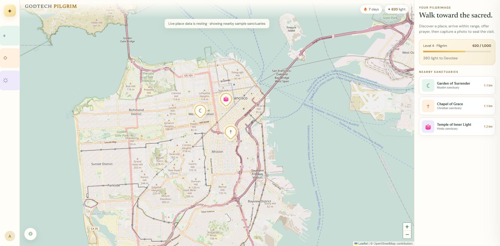

# Web App — Godtech

> **Repository category:** Location-based web application

**A location-based spiritual pilgrimage experience that helps people build a lasting practice through sacred-place discovery, prayer offerings, verified visits, and gentle gamification.**



## Vision

Godtech explores how thoughtful technology can help people return to prayer, reflection, gratitude, and service. The experience is designed for pilgrims and spiritual seekers across traditions. It brings temples, churches, mosques, and other places of worship into one respectful discovery layer while keeping each visit centered on reverence rather than competition.

The product loop is simple:

1. Discover a nearby sacred place on the map.
2. Travel there in person.
3. Choose an intention and make a prayer offering.
4. Check in within the sanctuary's verification radius.
5. Capture a current photo as proof of the visit.
6. Earn light, maintain a devotion streak, and deepen a long-term spiritual journey.

## Current experience

- **Sacred-place discovery** — reads nearby `amenity=place_of_worship` records from OpenStreetMap through the Overpass API.
- **Multi-faith map markers** — recognizes Hindu, Buddhist, Christian, Muslim, Jewish, Sikh, and general sacred places.
- **Place imagery** — displays Wikimedia Commons imagery when the map record provides an `image` or `wikimedia_commons` tag.
- **Location-aware check-ins** — compares the visitor's current coordinates with the selected sanctuary and requires the visitor to be within 250 meters.
- **Prayer offerings** — lets pilgrims dedicate a visit to gratitude, healing, or guidance.
- **Photo proof** — opens the device camera or photo picker and requires a fresh image before a visit can be completed.
- **Pilgrim progression** — rewards verified visits with light points and presents streaks, levels, and progress toward becoming a Devotee.
- **Directions** — opens turn-by-turn directions to the selected sacred place.
- **Responsive design** — provides a map-first desktop layout and a compact, touch-friendly mobile experience.
- **Graceful fallback** — supplies sample sanctuaries when location permission or live map data is unavailable.

## Design direction

Godtech uses a calm spiritual daylight palette rather than a heavy game interface:

- warm ivory for peace and clarity;
- temple gold for devotion and earned progress;
- sacred green for presence and successful verification;
- lotus rose and soft violet for prayer categories and icon backgrounds;
- rounded, clean icon tiles that remain readable on mobile;
- a softened map treatment that keeps sacred-place markers visually prominent.

The interface borrows the immediacy of location-based exploration games while avoiding combative language, scarcity mechanics, or rankings between faiths.

## How verification works

The prototype asks for location only when it needs to center the map or verify a check-in. A pilgrimage is completed when all three conditions are satisfied:

- the pilgrim is within **250 meters** of the selected place;
- a prayer intention has been selected;
- a photo has been captured or chosen on the device.

Current progress and visit metadata are stored in the browser on the pilgrim's device. The photo preview is held only for the active session and is not uploaded to a server in this prototype.

> Production verification should use authenticated accounts, server-side distance validation, durable encrypted photo storage, consent and retention controls, moderation, duplicate-image detection, timestamp checks, and a humane appeal process. GPS and a single image can discourage casual cheating, but they cannot prove physical presence with certainty.

## Technology

| Area | Implementation |
| --- | --- |
| Interface | Semantic HTML, CSS, and vanilla JavaScript |
| Map | Leaflet |
| Map tiles and places | OpenStreetMap |
| Place search | Overpass API |
| Place photos | Wikimedia Commons links supplied by map records |
| Device capabilities | Browser Geolocation and File/Camera APIs |
| Prototype state | `localStorage` |
| Hosting | OpenAI Sites configuration included in `.openai/hosting.json` |

## Run locally

No build step is required.

```bash
cd dist
python -m http.server 8765
```

Open `http://localhost:8765` in a browser. Location and camera behavior work best in a secure browser context. `localhost` is treated as secure by modern browsers.

## Project structure

```text
Web-App-Godtech/
├── .openai/
│   └── hosting.json       # Sites hosting configuration
├── dist/
│   └── index.html         # Complete application
├── docs/
│   └── godtech-preview.png
├── .gitignore
└── README.md
```

## Responsible product principles

- **Respect every tradition.** Sacred places are presented without ranking one faith above another.
- **Reward consistency, not compulsion.** Streaks should encourage a healthy rhythm and allow rest, travel, illness, and observance differences.
- **Protect sacred spaces.** The app should support venue-specific photography rules and never encourage disruptive behavior.
- **Minimize sensitive data.** Precise location and prayer photos require explicit purpose, short retention, strong access controls, and clear deletion tools.
- **Keep prayer sincere.** Points support the habit; they are not a measure of spiritual worth.
- **Design for safety.** Pilgrims should receive travel, accessibility, opening-hour, and local guidance before visiting unfamiliar places.

## Roadmap

- Account-based pilgrim profiles and cross-device progress
- Durable visit records with encrypted photo evidence
- Server-side geofence and anti-replay validation
- Community-maintained sanctuary pages and photography policies
- Daily, weekly, and monthly devotion journeys
- Wisdom journal and teachings curated with faith advisors
- Accessibility, opening hours, events, and trusted venue contacts
- Private groups for families, congregations, and pilgrimage circles
- Moderation, reporting, consent, retention, and deletion workflows
- Native mobile apps with more reliable camera and location attestation

## Status

Godtech is an interactive product prototype. Its discovery, map, directions, prayer-selection, location-check, photo-selection, and progression flows are functional in the browser. Authentication, cloud photo storage, automated image validation, moderation, and production-grade anti-cheat controls are planned work.

## Contributing

Ideas and contributions are welcome, especially from faith leaders, privacy engineers, accessibility specialists, cartographers, and community safety practitioners. Please approach new features with respect for religious differences and the privacy of visitors and places of worship.

## Data attribution

Map data is © [OpenStreetMap contributors](https://www.openstreetmap.org/copyright). Place images, when available, are resolved from Wikimedia Commons references present in individual OpenStreetMap records and remain subject to their source licenses.

## License

No open-source license has been selected yet. All rights are reserved by the repository owner unless a license is added later.
